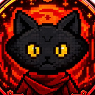
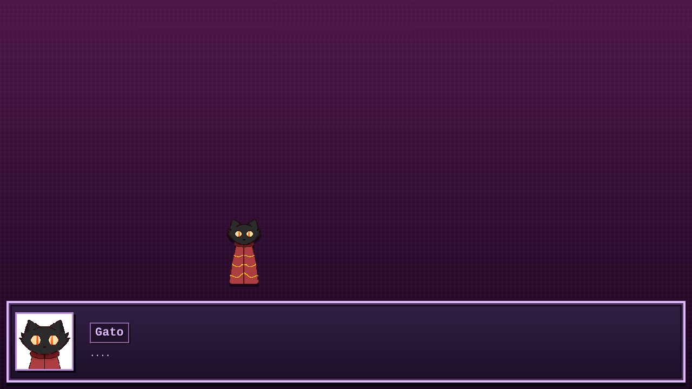
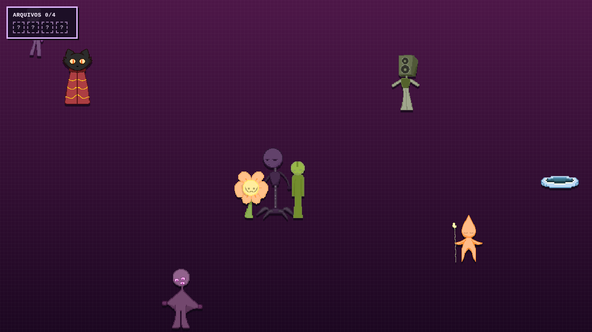
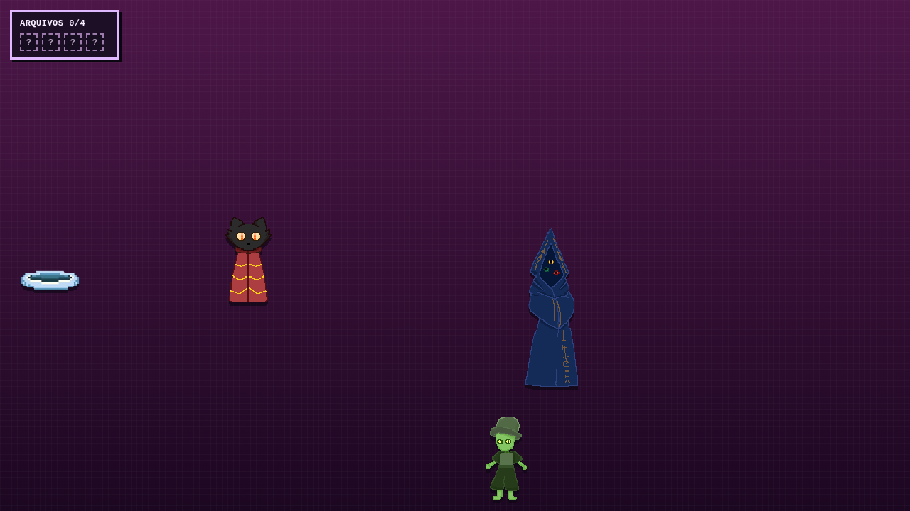
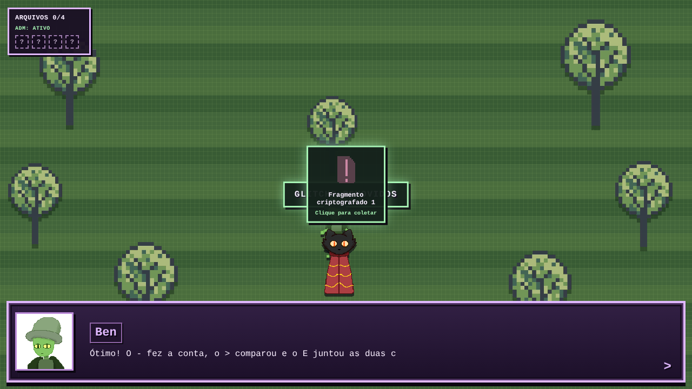
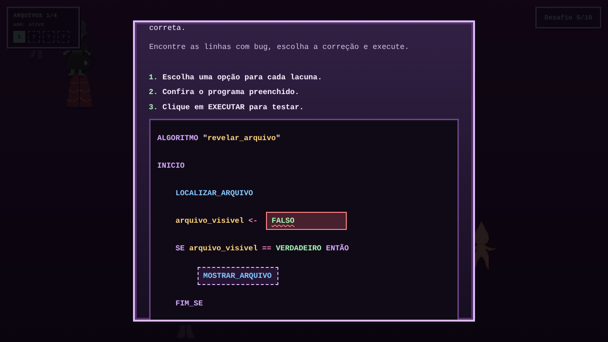
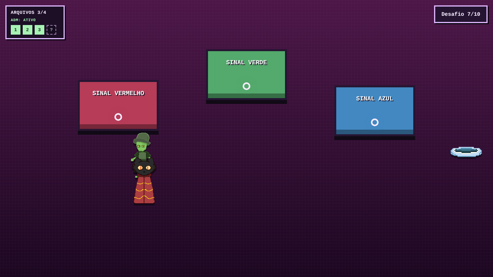
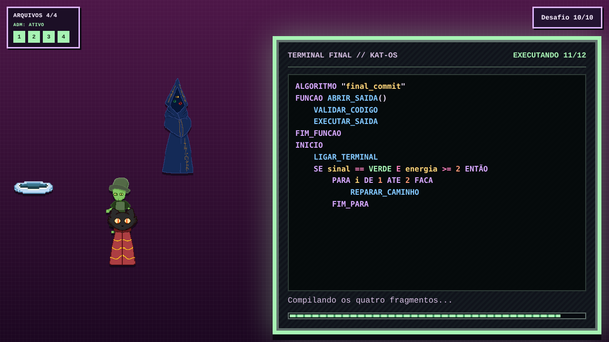

<div align="center">



# KAT

**Um gato preso dentro de um programa. A única saída é aprender a programar.**

Jogo educativo de lógica de programação feito em HTML, CSS e JavaScript puro.
Roda direto no navegador, no computador ou no celular.

**[▶ Jogar agora](https://gb65079.github.io/Gato/)**

</div>

---

## 📖 A história

KAT é um gato comum que adora cochilar em cima do teclado do seu dono programador.
Numa dessas sonecas, ele é **abduzido para dentro de um mundo digital abandonado e corrompido**:
caminhos interrompidos, glitches pelo chão e moradores escondidos das falhas.

Para voltar para casa, KAT precisa encontrar **Chromicos**, o guardião desse mundo.
Ele explica que a saída só vai aparecer quando o programa que a controla estiver completo,
e para isso KAT terá de **aprender a programar**.

Acompanhado de **Ben**, aprendiz de Chromicos, KAT atravessa o Refúgio, o Bazar Oculto, o Jardim,
a Lacuna Profunda, o Laboratório e as plataformas de teletransporte. No caminho ele resolve desafios de código,
recupera os **quatro fragmentos criptografados** do programa de saída e, no **Terminal Final**,
executa o último algoritmo. Mas será que foi tudo real?

<p align="center">
  
  
</p>

## 🐾 Personagens

| Personagem | Quem é |
|---|---|
| **KAT** | O gato protagonista, que foi parar dentro do programa. |
| **Chromicos** | Guardião do mundo e programador experiente. Mostra o caminho e abre o terminal final. |
| **Ben** | Aprendiz de Chromicos. Acompanha KAT e abre as telas de código. |
| **Célio** | Robô vendedor de peças e scripts no Bazar Oculto. Restaura o acesso de administrador. |
| **Piona** | Professora da Lacuna Profunda. Decifra os fragmentos de código. |
| **Biro** | Morador do Refúgio. É quem recebe KAT nesse mundo. |

<p align="center">
  
  
</p>

## 🧠 O que se aprende

São **10 desafios**, e cada um ensina um conceito novo em pseudocódigo no estilo Portugol.
O jogador completa as lacunas escolhendo opções, sem precisar digitar código.

| # | Cenário | Conceito |
|---|---|---|
| 1 | Sala Binária | **Algoritmo**: uma sequência de passos em ordem |
| 2 | Bazar Oculto | **Funções e parâmetros**: reaproveitar código |
| 3 | Jardim | **Operadores** aritméticos, relacionais e lógicos |
| 4 | Lacuna Profunda | **Se / Senão**: tomar decisões |
| 5 | Refúgio | **Depuração**: encontrar e corrigir bugs |
| 6 | Laboratório | **Laços de repetição** (`PARA`) |
| 7 | Plataformas | **Condicionais avançadas** (`SE / SENÃO SE / SENÃO`) |
| 8 | Lacuna Profunda | **Algoritmo completo**, juntando as peças 🎉 |
| 9 | Sala Binária | **Condições dentro de laços** (`ENQUANTO` + `SE`) |
| 10 | Terminal Final | **Desafio final**: funções, condições e laços 🎉 |

<p align="center">
  
  
</p>

<p align="center">
  
</p>

## 🎮 Como jogar

| Ação | Teclado | Celular / tablet |
|---|---|---|
| Andar | Setas ou **W A S D** | Direcional na tela |
| Conversar / avançar diálogo | **E** ou **Enter** | Botão **E** ou tocar na caixa de diálogo |
| Avançar cenas da história | **C** | Botão **C** |
| Usar portal | **P** | Botão **P** |
| Responder desafios | Mouse | Toque |

> No celular, jogue com o aparelho **na horizontal**.
> Errou um desafio? Você perde o acesso de administrador, mas o Célio, no Bazar Oculto, restaura sem custo.

## 💻 Rodar no computador

Não precisa instalar nada. Basta servir a pasta com qualquer servidor estático:

```bash
# opção 1: Python
python -m http.server 8000

# opção 2: VS Code
# extensão "Live Server" → botão "Go Live"
```

Depois, abra `http://localhost:8000` no navegador.

## 🗂️ Estrutura

```
index.html            → abertura (abdução)
refuge.html           → Refúgio
binary-room.html      → Sala Binária
marketplace.html      → Bazar Oculto
garden.html           → Jardim
deepstrech.html       → Lacuna Profunda
laboratorio.html      → Laboratório
teleport.html         → Plataformas de teletransporte
final-commit.html     → Terminal Final
assets/scenes/        → roteiro e diálogos de cada cenário
assets/scripts/       → desafios, cenas, portais e controles
assets/sprites/       → personagens e motor de animação
assets/css/           → estilos
```

## 👥 Equipe

- **Letícia**, instrutora (SENAI)
- **Ezequiel**
- **Yasmin**
- **Gabriel**

Projeto desenvolvido no **SENAI** e apresentado no **Mundo SENAI**.

---

<p align="center"><code>Simulação executada por: KAT_</code></p>
